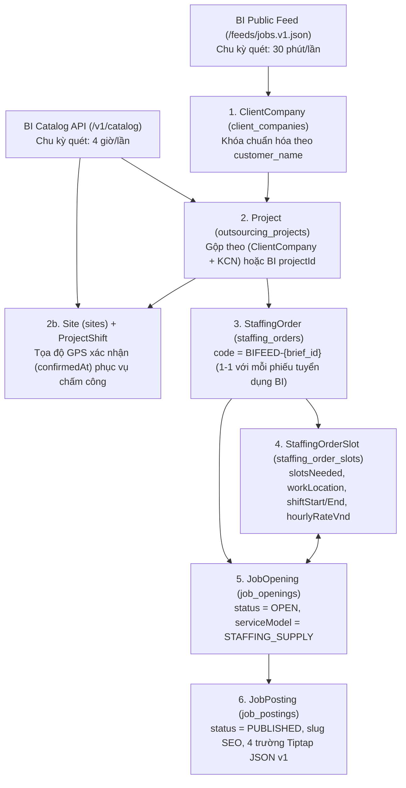

# Hợp đồng Đồng bộ Tin Tuyển dụng & Chuẩn hóa Phiếu Yêu cầu Tuyển dụng Dự án (BI → HRP v2.0)

- **Phiên bản:** `2.0.0` (Cập nhật theo feed chuẩn `https://bi.hrpartner.vn/feeds/jobs.v1.json` và mẫu *Phiếu yêu cầu tuyển dụng dự án*)
- **Ngày hiệu lực:** `2026-11-12`
- **Nguồn phát (Publisher):** Hệ thống `mini-bi` (`GET https://bi.hrpartner.vn/feeds/jobs.v1.json`)
- **Đích nhận (Consumer):** Hệ thống `HRP` (`vieclammienbac.com.vn` — `POST /api/cron/bi-jobs-feed`, chu kỳ 30 phút/lần)

---

## 1. Cấu trúc Chuẩn 4 Phần ("Phiếu yêu cầu tuyển dụng dự án")

Mọi tin tuyển dụng từ BI (`https://bi.hrpartner.vn/feeds/jobs.v1.json`) và biểu mẫu soạn tin trên HRP Admin (`/admin/jobs/job-postings/[id]`) đều thống nhất theo đúng 4 phần của **Phiếu yêu cầu tuyển dụng dự án**:

### Phần 1 — Thông tin chung dự án (`location` + `general`)
| Mục trên Phiếu giao việc | Trường trong `jobs.v1.json` | Ánh xạ vào HRP (`Project` / `StaffingOrderSlot` / `JobPosting.descriptionJson`) |
|---|---|---|
| Tên khách hàng (công ty/nhà máy) | `general.customer_name` | `ClientCompany.name`, `Project.clientCompanyName`, `JobPosting.title`, dòng mở đầu `descriptionJson` |
| Khu công nghiệp / địa chỉ nhà máy | `location.industrial_park_code`, `location.industrial_park_name`, `location.province_code`, `location.province_name` | `Project.siteAddress` & `StaffingOrderSlot.workLocation` = `"${industrial_park_name}, ${province_name}"` |
| Vốn đầu tư (Việt/Hàn/Trung/Nhật...) | `general.investment_origin` | Mục **Vốn đầu tư** trong `descriptionJson` |
| Ngành nghề sản xuất | `general.manufacturing_industry` | `ClientCompany.industry` + Mục **Ngành nghề sản xuất** trong `descriptionJson` |
| Công việc | `general.job_description` | `StaffingOrderSlot.positionTitle` + Mục **Công việc cụ thể** trong `descriptionJson` |
| Môi trường & Tư thế làm việc | `general.environment_types` (`CLEAN_ROOM` / `NORMAL_ROOM` / `SEMI_CLEAN_ROOM`), `general.work_postures` (`STANDING` / `SITTING`) | Mục **Môi trường & Tư thế làm việc** trong `descriptionJson` |
| Thời gian / Ca làm việc | `general.shift_pattern` (`DAY_ONLY` / `TWO_SHIFTS` / `THREE_SHIFTS` / `OTHER`), `general.shift_details` | `StaffingOrderSlot.shiftStart` / `shiftEnd` (phục vụ bộ lọc Ca ngày/Ca đêm) + Mục **Thời gian làm việc** trong `descriptionJson` |
| Quản lý / SĐT người phụ trách | *(Chỉ lưu nội bộ bên BI, đã ẩn khỏi feed công khai theo `PUBLIC_JOBS_FEED_V1_FORBIDDEN_INTERNAL_KEYS`)* | Không hiển thị công khai trên web ứng viên |
| Hình thức tuyển dụng | `general.labor_types[]` (`PERMANENT` Chính thức / `TEMPORARY` Thời vụ) | Đưa vào `JobPosting.title`, `StaffingOrder.description` (để bộ lọc `thoi_vu` / `toan_thoi_gian` nhận diện tự động) và `descriptionJson` |
| Lịch cấp | `general.supply_schedule_text` | Mục **Lịch cấp nhân sự** trong `descriptionJson` |
| Số lượng dự kiến | `general.expected_headcount` | `StaffingOrderSlot.slotsNeeded` (mặc định `50` nếu `null` hoặc `0`) + hiển thị trong `title` & `descriptionJson` |

### Phần 2 — Yêu cầu ứng viên (`candidate` → `JobPosting.requirementsJson`)
| Tiêu chí trên Phiếu giao việc | Trường trong `jobs.v1.json` | Nội dung hiển thị trong `requirementsJson` |
|---|---|---|
| Độ tuổi (từ – đến) | `candidate.age_min`, `candidate.age_max` | Ví dụ: `18 – 42 tuổi` |
| Giới tính | `candidate.gender_requirement` (`FEMALE` / `MALE` / `ANY`), `candidate.gender_label` | `Nữ` / `Nam` / `Nam/Nữ` |
| Trình độ học vấn tối thiểu | `candidate.education_requirement` (`SECONDARY` / `HIGH_SCHOOL` / `NONE`) | `Tốt nghiệp THCS (cấp 2)` / `Tốt nghiệp THPT (cấp 3)` / `Không yêu cầu bằng cấp` |
| Kinh nghiệm | `candidate.experience_required`, `candidate.experience_details` | `Không yêu cầu kinh nghiệm` hoặc `Yêu cầu có kinh nghiệm (${experience_details})` |
| Nhận lại NLĐ đã từng làm tại công ty KH | `candidate.accept_former_customer_workers` | `Có nhận lại lao động đã từng làm tại nhà máy` / `Không nhận lại lao động cũ của nhà máy` |
| Hình thức kiểm tra đầu vào | `candidate.entry_assessment_text` | Ví dụ: `Phỏng vấn trực tiếp, test bảng chữ cái, không mù màu` |
| Yêu cầu khác | `candidate.other_requirements_text` | Hiển thị nguyên văn (nếu có) |

### Phần 3 — Chế độ lương, thưởng, phúc lợi (`compensation` → `JobPosting.salaryDisplay`, `StaffingOrderSlot.hourlyRateVnd`, `JobPosting.benefitsJson`)
| Khoản mục trên Phiếu giao việc | Trường trong `jobs.v1.json` | Ánh xạ vào HRP |
|---|---|---|
| Thu nhập bình quân dự kiến / tháng | `average_income_min_vnd`, `average_income_max_vnd` | Ưu tiên số 1 cho `JobPosting.salaryDisplay` (ví dụ `9.000.000 – 12.000.000 ₫/tháng`) và `StaffingOrderSlot.hourlyRateVnd` (để bộ lọc mức lương `5–10 triệu`, `10–15 triệu` và dải "Việc làm lương cao nhất" hoạt động chính xác) |
| Lương cơ bản | `base_salary_vnd`, `base_salary_conditions` | Kèm trong `salaryDisplay` (nếu có) và mục **Chế độ lương & phụ cấp** trong `benefitsJson` |
| Thưởng chuyên cần | `attendance_bonus_vnd`, `attendance_bonus_conditions` | Mục **Thưởng chuyên cần** trong `benefitsJson` |
| Phụ cấp Đời sống / Thâm niên / Soi kính / Khác | `living_allowance_*`, `seniority_allowance_*`, `eyesight_allowance_*`, `other_allowance_text` | Danh sách phụ cấp chi tiết trong `benefitsJson` |
| Ngày thanh toán lương / Ứng lương / Lương tuần | `salary_payment_schedule`, `salary_advance_*`, `weekly_salary_*` | Mục **Lịch thanh toán & Ứng lương** trong `benefitsJson` |
| Đơn giá ca làm việc (8 dòng) | `day_shift_8h_vnd`, `day_shift_11h_vnd`, `night_shift_8h_vnd`, `night_shift_11h_vnd`, `sunday_day_11h_vnd`, `sunday_night_11h_vnd`, `holiday_day_11h_vnd`, `holiday_night_11h_vnd` | Mục **Đơn giá công theo ca** trong `benefitsJson` (chỉ liệt kê các ca có đơn giá `> 0`) |
| Đồng phục, bảo hộ lao động & Phúc lợi khác | `ppe_provided`, `ppe_details`, `other_benefits` | Mục **Đồng phục & Phúc lợi khác** trong `benefitsJson` |

### Phần 4 — Hồ sơ ứng viên cần chuẩn bị (`documents` → `JobPosting.applicationInstructionsJson`)
- Tổng hợp từ 7 cờ boolean trong `documents`:
  1. `require_original_cccd_and_copy`: CCCD (bản gốc + photo)
  2. `require_certified_resume`: Sơ yếu lý lịch có xác nhận
  3. `require_health_certificate_within_6_months`: Giấy khám sức khỏe (trong vòng 6 tháng)
  4. `require_photo_3x4`: Ảnh 3x4
  5. `require_degree_or_certificate`: Bằng cấp / chứng chỉ (nếu có)
  6. `require_social_insurance_book`: Sổ BHXH (nếu có)
  7. `require_other_documents` + `other_documents_text`: Giấy tờ khác
- Render danh sách giấy tờ cần chuẩn bị kèm hướng dẫn bấm nút **"Ứng tuyển ngay"** trực tiếp trên trang việc làm.

---

## 2. Tổ chức & Đối soát Dữ liệu Dự án – Tin Tuyển dụng trong Database HRP

Khi HRP nhận dữ liệu từ **Feed Việc làm (`https://bi.hrpartner.vn/feeds/jobs.v1.json`)** và từ **API Đồng bộ Dự án/Nhân sự (`/api/integrations/hrp/v1/catalog`)**, hệ thống sắp xếp vào chuỗi bảng chuẩn của HRP như sau:

### Quy tắc liên kết & vòng đời:
1. **`ClientCompany` (Khách hàng / Nhà máy):**
   - Chuẩn hóa `general.customer_name` (NFC, chữ thường, gộp khoảng trắng) để tìm `ClientCompany` hiện có theo tên hoặc mã `BICC-{hash12}`. Nếu chưa có thì tạo mới với `status = 'ACTIVE'`, `industry = general.manufacturing_industry`.
2. **`Project` (`outsourcing_projects` — Dự án):**
   - Mỗi tổ hợp `(ClientCompany, industrial_park_code)` ánh xạ về 1 `Project` (`code = BIPRJ-{industrial_park_code}-{hash8}`).
   - Nếu trong HRP đã có sẵn `Project` của cùng `ClientCompany` tại cùng KCN (do Admin tạo hoặc do `/v1/catalog` đồng bộ sang), hệ thống **tái sử dụng ngay `Project` đó** thay vì tạo trùng.
   - Nhờ vậy, khi một dự án có nhiều phiếu tuyển dụng (`brief_id`) khác nhau trên BI (ví dụ nhà máy Minh Đức tại KCN Bá Thiện 1 có 2 tin đăng độc lập), tất cả đều nằm chung dưới **1 `Project`** duy nhất, đồng bộ với luồng phân công & chấm công NLĐ.
3. **`StaffingOrder` → `StaffingOrderSlot` → `JobOpening` → `JobPosting` (1-1 theo `brief_id`):**
   - Mỗi `brief_id` trong feed ánh xạ 1-1 với `StaffingOrder.code = "BIFEED-" + brief_id`.
   - Phiên bản đồng bộ được lưu trong dấu `[BI_FEED_V1 version={version} brief_id={brief_id}]`.
   - **Khi có `brief_id` mới:** Tự động tạo đầy đủ chuỗi 4 bản ghi và xuất bản ngay (`JobPosting.status = 'PUBLISHED'`).
   - **Khi `job.version` tăng (hoặc tin từng bị gỡ nay đăng lại):** Cập nhật nội dung 4 phần, mức lương, số lượng tuyển, tăng `JobPosting.revision` và đảm bảo `status = 'PUBLISHED'`.
   - **Khi `brief_id` biến mất khỏi `jobs[]` (đã gỡ `WITHDRAWN` bên BI):** Tự động chuyển `JobPosting.status = 'ARCHIVED'`, `JobOpening.status = 'CANCELLED'`, `StaffingOrder.status = 'CLOSED'` để ẩn khỏi trang việc làm công khai nhưng giữ nguyên toàn bộ hồ sơ ứng viên (`CandidateSubmission`) đã nộp trước đó.
   - **An toàn Fail-closed:** Nếu lệnh gọi `https://bi.hrpartner.vn/feeds/jobs.v1.json` gặp lỗi mạng, timeout hoặc sai `schema_version`, HRP giữ nguyên toàn bộ tin đang đăng và không bao giờ lưu trữ nhầm.
